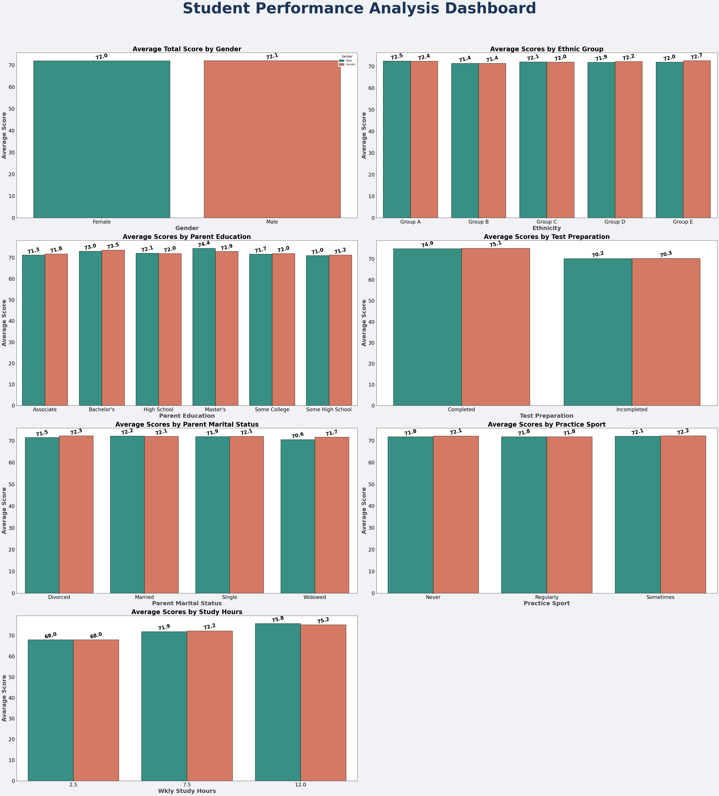
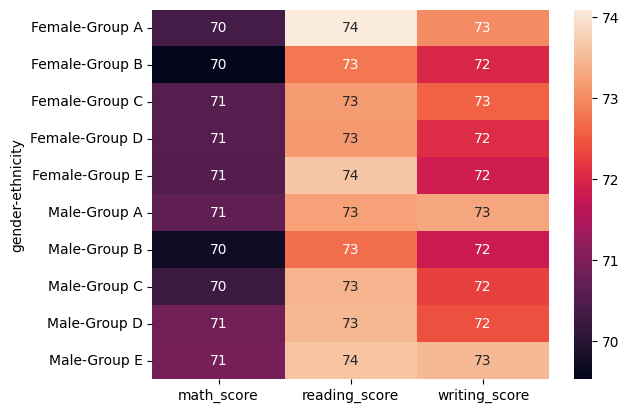

# Student Performance and Academic Insights Analysis

## Project Overview

This project focuses on analysing student academic performance using Python. The objective is to understand how different factors, such as gender, parental education, test preparation and weekly study hours, relate to students' academic scores.

The analysis uses approximately 10,000 student records to identify patterns, explore academic performance and generate meaningful insights.

## Business Objectives

- Analyse student performance across different subjects.
- Understand academic performance based on gender.
- Explore the relationship between parental education and student scores.
- Evaluate the relationship between test preparation and academic performance.
- Analyse the relationship between weekly study hours and academic results.
- Identify patterns that can help improve academic support strategies.

## Dataset Description

The dataset contains student demographic information and academic scores.

Important columns include:

| Column | Description |
|---|---|
| Gender | Student gender |
| EthnicGroup | Student ethnic group |
| ParentEduc | Parent education level |
| LunchType | Type of lunch |
| TestPrep | Test preparation course |
| ParentMaritalStatus | Parent marital status |
| PracticeSport | Sports participation |
| IsFirstChild | First-child status |
| NrSiblings | Number of siblings |
| TransportMeans | Transportation method |
| WklyStudyHours | Weekly study hours |
| MathScore | Mathematics marks |
| ReadingScore | Reading marks |
| WritingScore | Writing marks |

## Tools and Technologies

- Python
- Pandas
- NumPy
- Matplotlib
- Seaborn
- Google Colab
- Jupyter Notebook

## Data Cleaning and Preprocessing

The following activities were performed:

1. Dataset inspection.
2. Identification of missing values.
3. Duplicate record checking.
4. Handling missing values where required.
5. Data type verification.
6. Feature engineering.
7. Final dataset validation.

## Exploratory Data Analysis (EDA)

The project explores:

- Gender-wise academic performance.
- Subject-wise score comparison.
- Parent education and student performance.
- Test preparation and academic results.
- Weekly study hours and student performance.
- Sports participation and academic performance.
- Parent marital status and student scores.
- Ethnic group-wise academic performance.

## Key Performance Indicators

- Average Mathematics Score.
- Average Reading Score.
- Average Writing Score.
- Overall Average Score.
- Student Performance Categories.

## Dashboard Visualizations

### 1. Student Performance Analysis Dashboard

This dashboard presents academic performance across gender, ethnic groups, parental education, test preparation, parental marital status, sports participation and weekly study hours.

### 2. Gender and Ethnicity Subject Score Analysis

The heatmap compares Mathematics, Reading and Writing scores across gender and ethnic groups.

## Key Findings

Based on the dashboard analysis:

1. Male and female students show nearly similar average total scores.
2. Reading scores are generally higher than Mathematics scores.
3. Students who completed test preparation have higher average scores than those who did not.
4. Students in the 12-hour weekly study group show higher average scores than the other displayed study-hour groups.
5. Academic scores vary across parental education categories.
6. Differences between sports participation groups are relatively small.

## Business Recommendations

Based on the observed patterns:

- Encourage students to participate in structured test preparation activities.
- Provide additional academic support in Mathematics where needed.
- Encourage consistent study habits.
- Monitor student performance across different demographic groups.
- Use academic performance data to identify students who may benefit from additional learning support.

## Business Insights

For detailed findings and recommendations, refer to:

[View Detailed Business Insights](business_insights.md)

## Project Files

| File | Description |
|---|---|
| Student_performance_Analysis.ipynb | Python analysis notebook |
| student_performance_dataset.csv | Student dataset |
| student_performance_dashboard.png | Main dashboard |
| gender_ethnicity_subject_heatmap.png | Subject score heatmap |
| business_insights.md | Detailed business insights |
| Requirements.txt | Python dependencies |

## How to Run the Project

1. Clone or download this repository.
2. Install the required Python libraries using the requirements file.
3. Open the Jupyter Notebook.
4. Load the dataset.
5. Run the notebook cells sequentially.

## Author

**Chaitrali Gundolkar**

Aspiring Data Analyst | Python | SQL | Power BI | Excel
